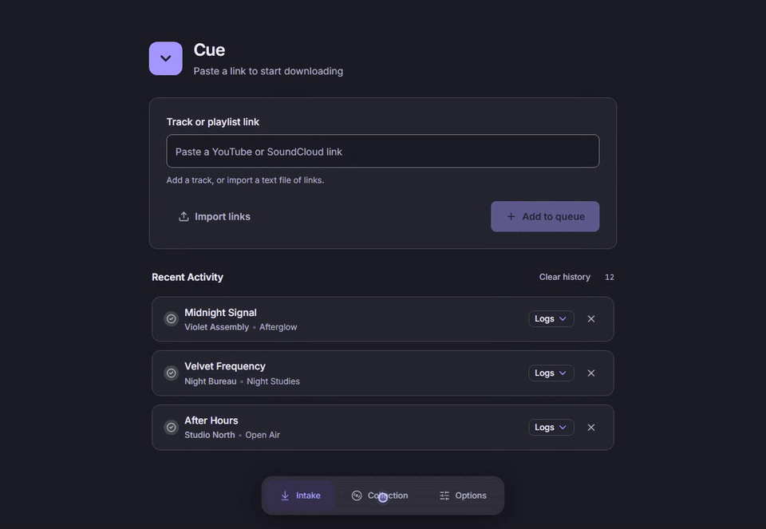

#  Cue

Download music and organize your tracks with tags. On Windows and macOS, turn those tags into Rekordbox playlists.

**[Download Cue](https://github.com/sousandrei/cue/releases)** for Windows, macOS, or Linux.

  

*Demo with sample tracks.*

## What you can do

- Download tracks and playlists from YouTube and SoundCloud.
- Save your music as MP3 files.
- Follow download progress and see recent activity.
- Search your collection by track, artist, album, or tag.
- Add tags to organize your music.
- Use your tags to manage Rekordbox playlists on Windows and macOS.

## Get started

1. Open Cue and choose a folder for your music. Cue completes the first-time setup for you.
2. Paste a track or playlist link into Intake. Select **Add to queue**.
3. Open Collection to find your tracks and add tags.

## Use Cue with Rekordbox

Available on Windows and macOS.

- Import your tracks into Rekordbox. Cue shows their BPM, key, and import status.
- Add tags in Cue. Each tag becomes a playlist in Rekordbox's **Cue** folder.
- Close Rekordbox to apply playlist changes. Reopen it to see the updated playlists.

Cue checks for library changes automatically and manages every playlist inside the **Cue** folder. Each playlist contains only imported tracks with the matching tag. Playlists for removed tags are deleted. Playlists outside that folder are left alone.

On Linux, you can use Collection and tags without Rekordbox support.

## Help and contributions

[Report a problem or request a feature](https://github.com/sousandrei/cue/issues).

To work on Cue's code or review its components in Storybook, see the [development guide](CONTRIBUTING.md).

## License

Cue is free software under the [GNU GPL v3](LICENSE.md) (GPL-3.0-only).
You can use, share, and modify it under that license. It comes without any warranty.
Third-party components keep their own licenses and copyright notices.
